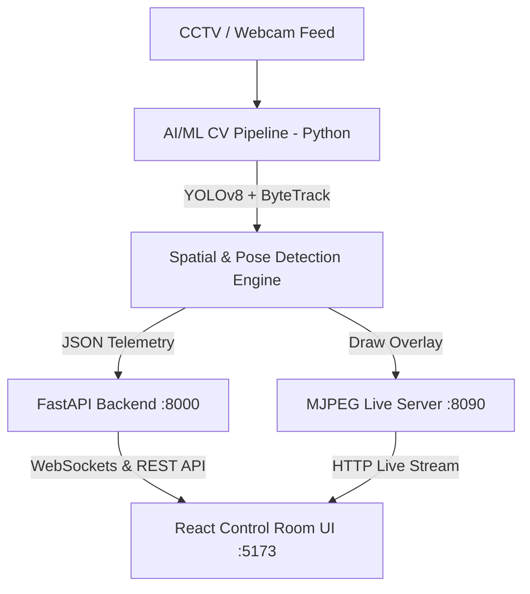

# 🚂 ANVESHA (RailGuard AI) — AI-Powered Railway Safety & Crowd Intelligence Platform

[](https://reactjs.org/)
[](https://vitejs.dev/)
[](https://www.python.org/)
[](https://docs.ultralytics.com/)
[](https://fastapi.tiangolo.com/)
[](LICENSE)

**ANVESHA** (RailGuard AI) is a next-generation, AI-driven railway safety monitoring, spatial crowd intelligence, and real-time incident telemetry platform. Designed specifically for railway station control rooms and high-density transportation hubs, ANVESHA delivers continuous computer vision surveillance, automated threat detection, risk-score calculation, and incident dispatching.

---

## 🌟 Key Features

- **🎥 Live CCTV & Telemetry Streaming**: Real-time MJPEG live stream server (`127.0.0.1:8090/stream`) processing webcam hardware (Index `0`) or RTSP/file video feeds with low latency.
- **🧠 Advanced Computer Vision & ML Pipeline**:
  - **Person Detection & Tracking**: Powered by YOLOv8 and scale-aware ByteTrack for robust multi-person ID persistence.
  - **Passenger Fall Detection**: Pose estimation keypoint geometry (Head-to-Hip vertical alignment and collapse checks) eliminating false positives.
  - **Restricted Zone & Track Intrusion**: Shapely polygon spatial intersection detecting unauthorized entry into track beds, signal gantries, and work zones.
  - **PPE Compliance Verification**: Color-space HSV masking detecting safety helmets and high-visibility vests in maintenance yards.
  - **Unattended Baggage Alerting**: Stationarity quantization tracking abandoned objects near concourses.
- **👥 Crowd Intelligence & Capacity Analytics**:
  - Real-time density heatmaps and occupancy percentages across platforms, FOB staircases, and waiting halls.
  - Predictive surge forecasting and capacity threshold alerts.
- **🎛️ Railway Control Room Dashboard**:
  - Customizable CCTV grid layouts (1x1, 2x2, 3x3, 4x4) optimized for 8–10 hour operator shifts.
  - Full-view camera inspection modal with interactive HUD, snapshot archiving, and alert details drawer.
  - Command palette (`Ctrl + K`) for instant navigation and action execution.
  - High-contrast Dark Mode design system adhering to railway operational aesthetics.

---

## 🏗️ System Architecture



---

## 🛠️ Technology Stack

| Domain | Technologies |
| :--- | :--- |
| **Frontend UI** | React 18, Vite, Tailwind CSS, Lucide Icons, Recharts, i18next |
| **Computer Vision / ML** | Python, OpenCV, Ultralytics YOLOv8, ByteTrack, Shapely, PyTorch |
| **Backend Services** | FastAPI, SQLite (SQLAlchemy ORM), WebSockets, Pydantic |
| **Streaming** | Threaded HTTP MJPEG Stream Server, OpenCV VideoCapture |

---

## 🚀 Quick Start Guide

### Prerequisites
- **Node.js** (v18.0 or higher)
- **Python** (v3.10 or higher)
- **Git**

### Option A: Launch Everything (One-Click Windows Script)

Double-click or execute from PowerShell / Command Prompt:
```bash
.\start_all.bat
```

---

### Option B: Manual Setup

#### 1. Clone Repository
```bash
git clone https://github.com/buildwithneel/ANVESHA.git
cd ANVESHA
```

#### 2. Frontend Setup
```bash
# Install Node dependencies
npm install

# Start Vite React Dev Server
npm run dev
```
> Frontend will run at `http://localhost:5173/`

#### 3. AI/ML Computer Vision Pipeline Setup
```bash
# Install Python ML requirements
pip install -r backend/requirements.txt ultralytics opencv-python shapely

# Run Master CV Pipeline (Webcam Mode)
python ai_ml/main.py --source 0 --camera-id CAM-01

# Run Master CV Pipeline (Sample Video Mode)
python ai_ml/main.py --source videos/sample_cctv.mp4 --camera-id CAM-07 --draw-zones
```
> Live MJPEG stream available at `http://127.0.0.1:8090/stream`

#### 4. Backend API Setup
```bash
cd backend
python -m app.main
```
> FastAPI API available at `http://127.0.0.1:8000/`

---

## 📂 Project Structure

```
ANVESHA/
├── ai_ml/                      # Python Computer Vision & ML Core
│   ├── config/                 # Zone polygons & camera definitions (zones.json)
│   ├── detection/              # Crowd, Fall, PPE & Intrusion detectors
│   ├── events/                 # Event Engine & Risk Calculation Engine
│   ├── models/                 # YOLOv8 model loader & weight managers
│   ├── tracking/               # ByteTrack multi-object tracker
│   ├── utils/                  # Video stream handler & MJPEG server
│   ├── zones/                  # Shapely spatial polygon manager
│   └── main.py                 # Master CV Pipeline Execution Entrypoint
├── backend/                    # FastAPI Backend Application
│   ├── app/
│   │   ├── database/           # SQLite models, schemas, and seeds
│   │   ├── routes/             # REST API endpoints & WebSocket handlers
│   │   ├── services/           # Business logic & event ingestors
│   │   └── main.py             # FastAPI entrypoint
│   └── requirements.txt
├── src/                        # React Frontend Control Room UI
│   ├── components/             # Reusable UI cards, tables, modals & feeds
│   ├── data/                   # Station telemetry & mock data fallbacks
│   ├── hooks/                  # Custom React hooks (theme, keyboard shortcuts)
│   ├── pages/                  # Main views (Overview, Live CCTV, Incidents, Crowd)
│   ├── services/               # API clients, WebSocket service, event listeners
│   └── utils/                  # Formatters, class merge utilities
├── public/                     # Static assets, logos, sample video media
├── start_all.bat               # One-click startup script for Windows
└── README.md
```

---

## 👨‍💻 Authors & Credits

Developed with ❤️ for Smart India Hackathon (SIH) & Railway Safety Systems by:

- **Neel** — [*@buildwithneel*](https://github.com/buildwithneel)
- **Prathamesh Pandit** — [*@prathameshpandir-dev*](https://github.com/prathameshpandir-dev)

---

## 📜 License

This project is licensed under the MIT License — see the [LICENSE](LICENSE) file for details.
